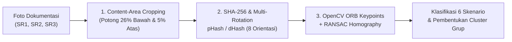

# 🌾 Sistem Audit & Deteksi Duplikasi Foto Dokumentasi Ubinan KSA
**Badan Pusat Statistik (BPS) Kabupaten Garut (3205)**

[](https://monitoring-ksa.vercel.app)
[](https://nextjs.org/)
[](https://supabase.com/)
[](https://opencv.org/)

🌐 **Akses Website Monitoring:** **[https://monitoring-ksa.vercel.app](https://monitoring-ksa.vercel.app)**

---

## 📌 Tentang Sistem Ini

**Quality Assurance Foto Ubinan KSA** adalah sistem kendali mutu otomatis berbasis *Computer Vision* yang dirancang untuk memeriksa keaslian dan mendeteksi indikasi penggunaan foto dokumentasi berulang pada **Survei Ubinan Padi (Subround 1, Subround 2, dan Subround 3)** di aplikasi **FASIH-SM BPS Kabupaten Garut**.

Sistem ini memeriksa secara menyeluruh 4 variabel foto kuesioner ubinan:
1. `fotobidang` — Foto sketsa bidang sawah pada kertas
2. `foto_petak` — Foto petak sawah terpilih
3. `fotoplot` — Foto plot ubinan $2,5\text{ m} \times 2,5\text{ m}$
4. `fotoberat` — Foto penimbangan hasil ubinan dengan timbangan digital

---

## 🧠 Metodologi Deteksi 3 Lapis (Bebas Bias Watermark FASIH)

Foto dokumentasi dari FASIH-SM dan aplikasi *Timemark* memiliki watermark besar di bagian bawah (berisi logo FASIH, tanggal/jam, koordinat GPS, dan nama wilayah). Jika dibandingkan secara mentah, kemiripan template watermark dapat memicu *false positive*. Oleh karena itu, sistem ini menerapkan **3 tahapan penyaringan presisi**:



1. **Content-Area Cropping (`[5% .. 74%]` Tinggi Gambar)**
   Memotong otomatis 26% area bawah dan 5% area atas foto tempat banner watermark berada, sehingga algoritma murni membandingkan objek visual sawah, petak, sketsa, dan timbangan.
2. **Kriptografi `SHA-256` & Multi-Orientation Perceptual Hashing (`pHash` / `dHash`)**
   - `SHA-256` menangkap file gambar yang **identik 100% secara biner** tanpa perubahan.
   - `pHash` dan `dHash` (diuji pada 8 orientasi: normal, rotasi $90^\circ, 180^\circ, 270^\circ$, serta *flip*) menangkap foto yang sama meskipun telah **dikompresi ulang** (misalnya dikirim melalui WhatsApp) atau **diputar**.
3. **Verifikasi Geometris `OpenCV ORB` + `RANSAC Homography`**
   Mencocokkan ribuan titik fitur (*keypoints*) dengan uji konsistensi spasial RANSAC untuk menangkap foto yang **diambil beruntun di lokasi/timbangan yang sama**, **di-crop sebagian**, atau **diedit teks tanggal watermark-nya**.

---

## 🎯 6 Skenario Pemeriksaan

Setiap pasangan dan kelompok temuan diklasifikasikan secara otomatis ke dalam 6 skenario pengawasan:

| Kode | Nama Skenario | Penjelasan Temuan |
| :--- | :--- | :--- |
| **Skenario 1** | **Antar Petugas (Subround Sama)** | Foto yang sama digunakan oleh $\ge 2$ petugas (PCL) berbeda pada periode subround yang sama. |
| **Skenario 2** | **Petugas Sama (Lintas Subround)** | Petugas menggunakan kembali foto dokumentasi dari subround sebelumnya (misal foto SR1/SR2 diunggah lagi di SR3). |
| **Skenario 3** | **Antar Petugas (Lintas Subround)** | Foto milik seorang petugas pada subround lama digunakan oleh petugas lain pada subround berikutnya. |
| **Skenario 4** | **Petugas Sama (Beda Sampel)** | Petugas menggunakan foto yang sama untuk dua sampel rumah tangga / NKS berbeda pada subround yang sama. |
| **Skenario 5A** | **Lintas Jenis Foto (1 Sampel)** | Foto diunggah ganda pada blok variabel berbeda di dalam 1 sampel yang sama (misal `foto_petak` = `fotoplot`). |
| **Skenario 5B** | **Lintas Jenis Foto (Beda Sampel)** | Foto dari suatu variabel digunakan ulang sebagai variabel lain pada sampel ubinan yang berbeda. |

---

## ✨ Fitur Utama Web Monitoring ([monitoring-ksa.vercel.app](https://monitoring-ksa.vercel.app))

- 🔒 **Sistem Login & Proteksi Role-Based (`admin` vs `user`)**:
  - Halaman depan publik hanya menampilkan pengantar sistem tanpa mengekspos data sampel/petugas.
  - Seluruh API data dilindungi oleh *Signed HTTP-Only Session Cookie*.
- 📊 **Ringkasan Eksekutif & Rekapitulasi per Petugas (PCL)**:
  - Menampilkan peringkat keterlibatan petugas beserta rincian pola duplikasinya (*Lintas Petugas*, *Antar Sampel*, *Internal Sampel*), fitur pencarian petugas, serta tombol **Unduh CSV** untuk laporan Excel.
  - Tabel **Sebaran Seluruh Kecamatan** dan **Matriks Skenario** yang interaktif (klik baris untuk langsung memfilter bukti foto).
- 🧩 **Pengelompokan Multi-Foto (*Connected-Component Clusters*)**:
  - Jika sebuah foto dipakai berulang kali (misal 3, 5, hingga 9 kali), seluruh foto tersebut disatukan dalam satu kartu grup (`GRP-001`, dst.) agar mudah diperiksa sekaligus.
- ⚡ **Pagination Hemat Kuota & Filter Lengkap**:
  - Dilengkapi filter **Skenario**, **Subround (`SR1`, `SR2`, `SR3`)**, **Jenis Foto**, **Relasi Petugas**, dan **Pencarian Kata Kunci**.
  - Sistem *pagination* (10 / 20 / 50 item per halaman) memastikan browser hanya memuat foto pada halaman yang sedang dibuka.
- 🔗 **Integrasi Link Langsung ke FASIH-SM**:
  - Setiap kartu foto dilengkapi tombol **"Buka FASIH ↗"** yang langsung membuka detail *assignment* terkait di `fasih-sm.bps.go.id`.
- 🌙 **Mode Gelap (*Dark Mode*)**:
  - Tersedia tombol saklar Mode Terang / Mode Gelap di pojok kanan atas untuk kenyamanan pemeriksaan visual.

---

## 📖 Panduan Penggunaan (Cara Pakai)

### A. Untuk Tim Pemeriksa / Pengawas (Role: `user`)
1. Buka **[https://monitoring-ksa.vercel.app](https://monitoring-ksa.vercel.app)**.
2. Klik tombol **"Masuk Sistem"** atau **"Masuk ke Ruang Pemeriksaan"**, lalu login menggunakan akun Pemeriksa (`user`).
3. Pada tab **Ringkasan & Petugas**:
   - Lihat tabel **Rekapitulasi Indikasi Duplikasi per Petugas**.
   - Klik tombol **"Lihat Grup"** atau **"Pasangan"** pada baris nama petugas untuk langsung memeriksa foto-foto milik petugas tersebut.
   - Klik **"Unduh CSV"** jika ingin mengunduh tabel rekapitulasi petugas ke Excel.
4. Pada tab **Kelompok Foto Sama** atau **Perbandingan Pasangan**:
   - Gunakan filter **Subround** (misal pilih `SR3`), **Skenario**, atau **Jenis Foto** sesuai fokus pemeriksaan.
   - Klik pada gambar untuk memperbesar (*Zoom Lightbox*).
   - Klik tombol **"Buka FASIH ↗"** di bagian bawah kartu foto untuk membuka isian kuesioner sampel tersebut langsung di web FASIH-SM (pastikan browser sudah login ke FASIH-SM).

---

### B. Untuk Administrator: Menarik Data Baru dari FASIH-SM (Role: `admin`)
Sistem dilengkapi fitur **Update Inkremental Pintar** yang otomatis melewati (*skip*) ribuan foto lama yang sudah ada di katalog Supabase dan **hanya mengambil foto yang benar-benar baru**.

#### Cara 1: Full dari Browser (Otomatis via Web & GitHub Actions)
1. Login ke **[https://monitoring-ksa.vercel.app](https://monitoring-ksa.vercel.app)** menggunakan akun **Admin**, lalu buka tab **Tarik Data FASIH**.
2. Pada **Langkah 1**, pilih periode **Subround** (misal `SR3`), lalu klik tombol **"Salin Kode Console"**.
3. Buka **[https://fasih-sm.bps.go.id](https://fasih-sm.bps.go.id)** di tab browser dan pastikan sudah login.
4. Tekan `F12` (atau `Klik Kanan -> Inspect`), buka tab **Console**, tempelkan (*paste*) kode tadi, lalu tekan **Enter**.
   - Script akan menarik daftar assignment, melewati foto lama, mengunduh & menghitung `SHA-256` asli untuk **foto baru saja**, lalu otomatis mengunduh file `rekap_foto_ubinan_...json`.
5. Kembali ke tab **Tarik Data FASIH** di `monitoring-ksa.vercel.app`, lalu pada **Langkah 2** unggah file `.json` yang baru saja terunduh.
   - Browser akan langsung mengunggah foto baru ke Supabase Storage dan memicu **GitHub Actions** untuk memperbarui hasil deteksi duplikasi secara otomatis.

#### Cara 2: Menggunakan Shortcut Lokal di Laptop (Opsional / Kapan Saja)
Jika ingin menjalankan proses analisis foto baru langsung dari laptop (menggunakan koneksi internet lokal):
1. Setelah mengunggah file `.json` di web (atau menaruhnya di folder lokal), cukup klik 2x file **[`jalankan_update_lokal.bat`](./jalankan_update_lokal.bat)** atau jalankan perintah berikut di PowerShell:
   ```powershell
   python run_incremental_github.py
   ```
2. Script akan langsung mengunduh foto baru yang belum ada di `photo_catalog`, menjalankan deteksi `pHash` + `OpenCV ORB`, dan memperbarui database Supabase.

---

### C. Mengelola Akun Pengguna (Khusus `admin`)
1. Login sebagai **Admin** dan buka tab **Tarik Data FASIH**.
2. Gulir ke bagian bawah pada panel **Manajemen Akun & Hak Akses Pengguna (`app_users`)**.
3. Anda dapat menambahkan akun baru (memilih role `user` atau `admin`), memperbarui password akun, maupun menghapus akun secara langsung.

---

## 🗂️ Struktur Direktori Utama

```text
scraping-foto/
├── analyze_photos.py            # Engine utama deteksi duplikasi 3 lapis (SHA-256, pHash, OpenCV ORB)
├── sync_to_supabase.py          # Script sinkronisasi awal katalog, cluster, pasangan & kompresi WebP ke Supabase
├── run_incremental_github.py    # Worker inkremental (hanya memproses foto baru + auto-cleanup temp storage)
├── jalankan_update_lokal.bat    # Shortcut 1-klik untuk menjalankan update inkremental dari laptop
├── scrape_fasih_console.js      # Script mandiri penarik data & foto untuk Console FASIH-SM
├── supabase_schema.sql          # Skema tabel PostgreSQL & kebijakan Storage Supabase
├── .github/workflows/
│   └── analyze_ubinan.yml       # Workflow GitHub Actions untuk analisis terjadwal / otomatis
└── web-monitoring/              # Aplikasi Web Dashboard (Next.js App Router + Tailwind CSS)
    ├── public/bps_logo.webp     # Logo BPS pada header dan favicon
    └── src/
        ├── app/
        │   ├── page.tsx         # Halaman utama (Landing Page, Login Modal, & 4 Tab Dashboard)
        │   └── api/             # Endpoint API Terproteksi (audit-data, auth, users, upload-scrape, dll.)
        └── lib/
            ├── auth.ts          # Enkripsi sesi HMAC-SHA256 & manajemen role
            ├── supabase.ts      # Koneksi klien Supabase
            └── scraperTemplate.ts # Generator kode Console FASIH-SM dengan injeksi katalog inkremental
```

---

## 🛠️ Menjalankan Web Monitoring Secara Lokal (Development)

1. Masuk ke folder `web-monitoring` dan instal dependensi:
   ```powershell
   cd web-monitoring
   npm install
   ```
2. Pastikan variabel lingkungan di `.env` / `.env.local` sudah terisi:
   ```env
   NEXT_PUBLIC_SUPABASE_URL=https://xxxx.supabase.co
   NEXT_PUBLIC_SUPABASE_ANON_KEY=eyJ...
   ```
3. Jalankan server pengembangan:
   ```powershell
   npm run dev
   ```
4. Buka `http://localhost:3000` di browser.

---
*Dikembangkan untuk mendukung peningkatan kualitas data statistik pertanian — **BPS Kabupaten Garut**.*
